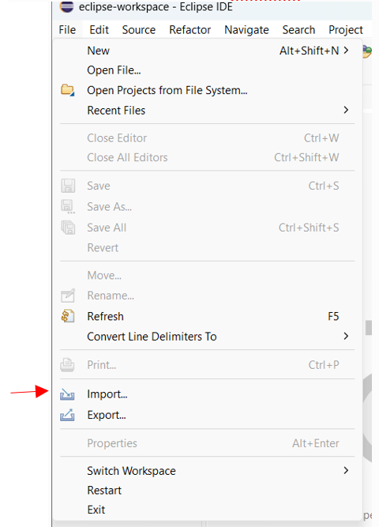
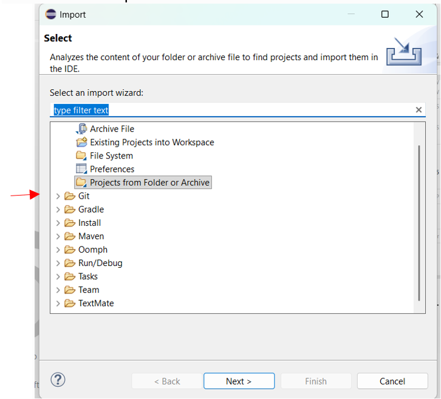
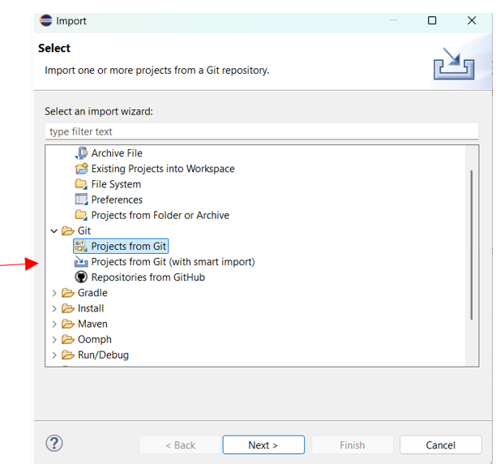
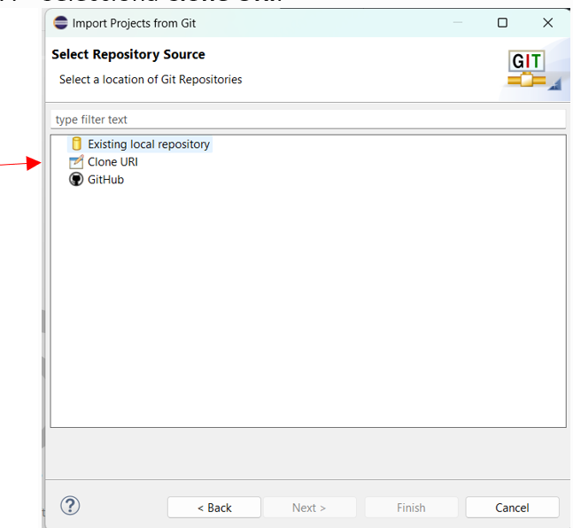
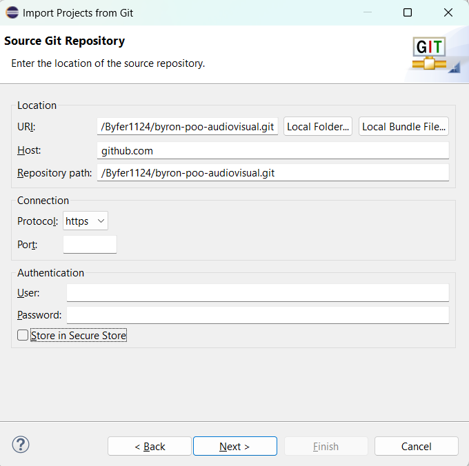

# Sistema de Gestión Audiovisual (POO)

📌 **Descripción del proyecto**

Este proyecto consiste en una aplicación desarrollada en Java, aplicando los principios de la Programación Orientada a Objetos (POO).

Su propósito principal es gestionar y modelar diferentes tipos de contenidos audiovisuales, como películas, series de televisión, documentales, noticieros y videos educativos, relacionándolos con actores, temporadas e investigadores.

El sistema permite organizar la información mediante clases, aplicando conceptos fundamentales de POO como abstracción, herencia, encapsulamiento, polimorfismo y relaciones entre clases.

---

🚀 **Instrucciones para clonar el proyecto desde Eclipse:**

1. Abre Eclipse IDE.


2. Selecciona **File → Import**.



3. Busca la carpeta **Git**.



4. Selecciona **Projects from Git** y presiona **Next**.



5. Selecciona **Clone URI** y presiona **Next**. Pega la siguiente URL: `https://github.com/Byfer1124/byron-poo-audiovisual.git`



6. Presiona **Next** y selecciona la rama principal (`main`). Selecciona la ubicación donde deseas guardar el proyecto y presiona **Finish** para completar la clonación.



---

⚙️ **Ejecutar la aplicación**

1. En el explorador de proyectos de Eclipse, localiza la clase principal que contiene el método `main`.
2. Haz clic derecho sobre el archivo.
3. Selecciona **Run As → Java Application**.
4. La aplicación se ejecutará en la consola de Eclipse.

---

📁 **Estructura del proyecto**

El repositorio está organizado de la siguiente manera:

```text
byron-poo-audiovisual/
├── img/                # Carpeta que contiene las imágenes y diagramas del proyecto
├── src/                # Código fuente principal de la aplicación en Java
│   ├── poo/            # Paquete con las clases principales y estructura base
│   └── uni1a/          # Paquete con las clases específicas y subclases asociadas
└── README.md           # Archivo de documentación del repositorio

📐 Diagrama UML

El proyecto incluye el archivo new_diagram.uxf, que contiene el diagrama UML de clases elaborado con UMLet.

Este diagrama representa la estructura del sistema, incluyendo la herencia y las relaciones de asociación, agregación y composición entre las clases.

🛠️ Tecnologías y herramientas
Lenguaje: Java.
IDE: Eclipse.
Control de versiones: Git y GitHub.
Diagramación UML: UMLet.
