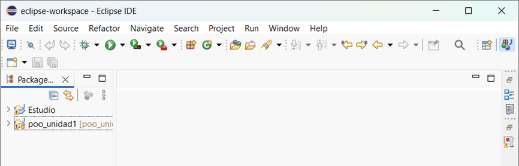

Sistema de Gestión Audiovisual (POO)
📌 Descripción del proyecto

Este proyecto consiste en una aplicación desarrollada en Java, aplicando los principios de la Programación Orientada a Objetos (POO).

Su propósito principal es gestionar y modelar diferentes tipos de contenidos audiovisuales, como películas, series de televisión, documentales, noticieros y videos educativos, relacionándolos con actores, temporadas e investigadores.

El sistema permite organizar la información mediante clases, aplicando conceptos fundamentales de POO como abstracción, herencia, encapsulamiento, polimorfismo y relaciones entre clases.

🚀 Instrucciones para clonar el proyecto desde eclipse:
1. Abre Eclipse IDE.
   
2. Selecciona File → Import.
    
Busca la carpeta Git.
Selecciona Projects from Git y presiona Next.
Selecciona Clone URI y presiona Next.
Pega la siguiente URL:

https://github.com/Byfer1124/byron-poo-audiovisual.git

Presiona Next y selecciona la rama principal (main).
Selecciona la ubicación donde deseas guardar el proyecto.
Presiona Finish para completar la clonación.
Importa el proyecto y verifica que aparezca en Package Explorer.
3. Ejecutar la aplicación
En el explorador de proyectos de Eclipse, localiza la clase principal que contiene el método main.
Haz clic derecho sobre el archivo.
Selecciona Run As → Java Application.
La aplicación se ejecutará en la consola de Eclipse.
📁 Estructura del proyecto

El repositorio está organizado de la siguiente manera:

text
byron-poo-audiovisual/
│
├── src/
│   ├── poo/
│   │   └── Clase principal con el método main
│   │
│   └── uni1a/
│       ├── Actor.java
│       ├── Pelicula.java
│       ├── Temporada.java
│       ├── SerieDeTV.java
│       ├── Documental.java
│       ├── Investigador.java
│       └── Otras clases del sistema
│
├── new_diagram.uxf
│
└── README.md

📐 Diagrama UML

El proyecto incluye el archivo new_diagram.uxf, que contiene el diagrama UML de clases elaborado con UMLet.

Este diagrama representa la estructura del sistema, incluyendo la herencia y las relaciones de asociación, agregación y composición entre las clases.

🛠️ Tecnologías y herramientas
Lenguaje: Java.
IDE: Eclipse.
Control de versiones: Git y GitHub.
Diagramación UML: UMLet.
