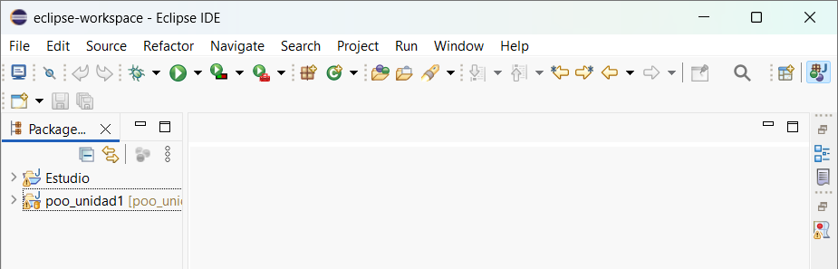
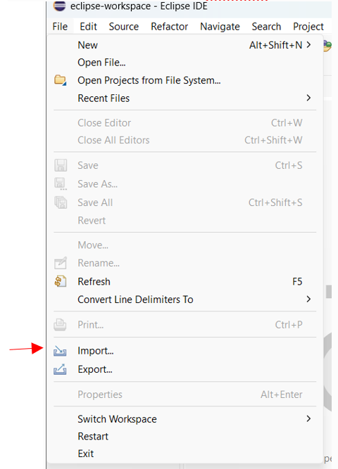
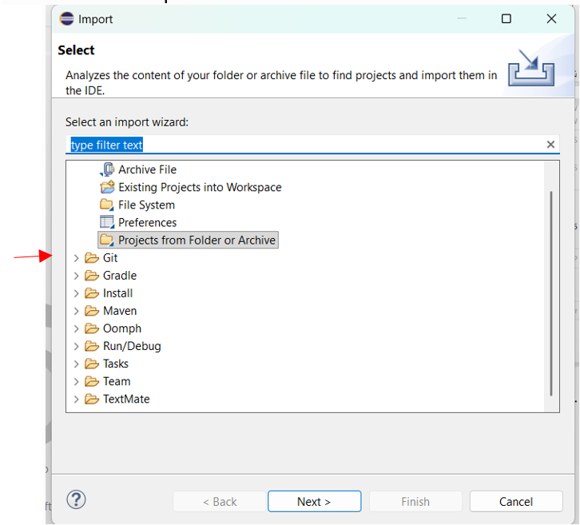
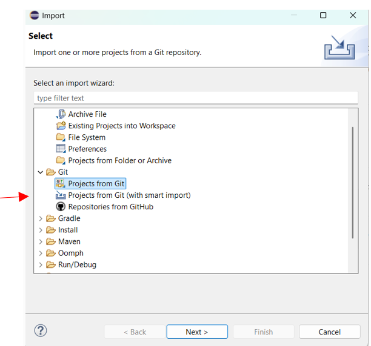
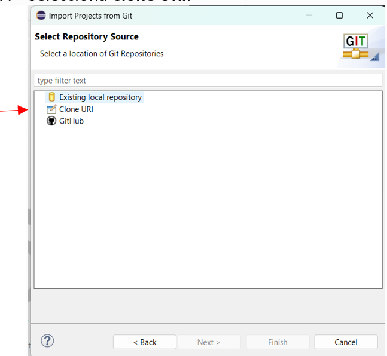
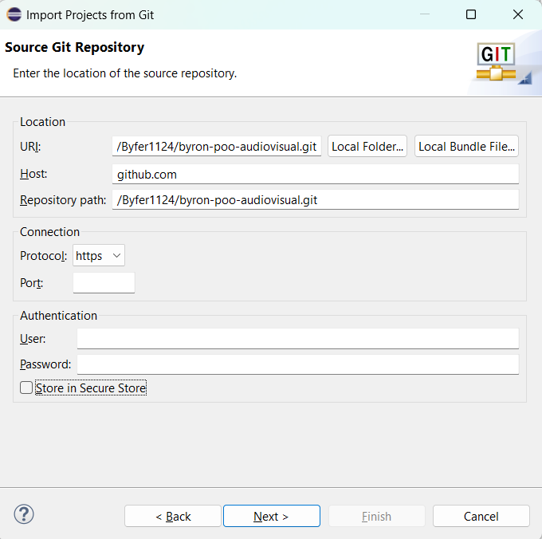

# Sistema de Gestión Audiovisual (POO)

📌 **Descripción del proyecto**

Este proyecto consiste en un sistema de gestión de contenido audiovisual desarrollado en Java 21, como parte de la asignatura de Programación Orientada a Objetos.

El sistema permite administrar diferentes tipos de contenido audiovisual, como películas, series de televisión, documentales, noticieros y videos educativos. Además, permite gestionar información relacionada con actores, investigadores y temporadas mediante archivos CSV.

Durante su desarrollo se aplicaron conceptos de programación orientada a objetos como abstracción, herencia, encapsulamiento, polimorfismo y relaciones entre clases, manejo de archivos, arquitectura MVC, principios SOLID y pruebas unitarias con JUnit 5.

---
**Funcionalidades principales:**

• Registrar películas, incluyendo su estudio cinematográfico y actores.

• Registrar series de televisión y sus temporadas.

• Registrar documentales y sus investigadores.

• Registrar noticieros con su presentador y cadena de televisión.

• Registrar videos educativos con su materia y nivel educativo.

• Consultar los contenidos registrados.

• Leer información desde archivos CSV.

• Guardar los contenidos y sus relaciones en archivos CSV.

• Gestionar la información mediante un menú de consola.

---

🛠️**Tecnologías utilizadas:**
• Java 21.

• Eclipse IDE.

• JUnit 5 (JUnit Jupiter).

• Archivos CSV para el almacenamiento de información.

• Git y GitHub para el control de versiones.

---

📁 **Estructura del proyecto**

El repositorio está organizado de la siguiente manera:

```text
byron-poo-audiovisual/
├── src/
│   ├── controlador/
│   │   └── ContenidoAudiovisualControlador.java
│   ├── modelo/
│   │   ├── Actor.java
│   │   ├── ContenidoAudiovisual.java
│   │   ├── Documental.java
│   │   ├── Investigador.java
│   │   ├── Noticiero.java
│   │   ├── Pelicula.java
│   │   ├── SerieDeTV.java
│   │   ├── Temporada.java
│   │   └── VideoEducativo.java
│   ├── persistencia/
│   │   ├── ContenidoArchivo.java
│   │   ├── ActorArchivo.java
│   │   ├── InvestigadorArchivo.java
│   │   ├── TemporadaArchivo.java
│   │   └── RelacionPeliculaActorArchivo.java
│   ├── vista/
│   │   ├── ContenidoAudiovisualVista.java
│   │   └── VistaContenido.java
│   └── poo/
│       └── PruebaAudioVisual.java
├── test/
│   └── pruebas/
├── datos/
│   ├── contenidos.csv
│   ├── actores.csv
│   ├── pelicula_actores.csv
│   ├── temporadas.csv
│   └── investigadores.csv
└── README.md

```
---

**Arquitectura MVC**
El proyecto utiliza el patrón Modelo-Vista-Controlador (MVC):
 
• Modelo: contiene las clases que representan los contenidos audiovisuales y sus elementos relacionados.

• Vista: presenta el menú de consola, recibe los datos del usuario y muestra la información.

• Controlador: coordina las operaciones del sistema, recibe las opciones del usuario y se comunica con el modelo y la persistencia.

• Persistencia: contiene las clases responsables de leer y guardar los datos en archivos CSV.

---

🚀 **Ejecución del proyecto:**

1. Clonar o descargar el repositorio.
2. Importar el proyecto en Eclipse IDE.
   1. Abre Eclipse IDE.

   

   2. Selecciona **File → Import**.

   

   3. Busca la carpeta **Git**.

   

   4. Selecciona **Projects from Git** y presiona **Next**.

   

   5. Selecciona **Clone URI** y presiona **Next**. Pega la siguiente URL:      `https://github.com/Byfer1124/byron-poo-audiovisual.git`

   

   6. Presiona **Next** y selecciona la rama principal (`main`). Selecciona la ubicación donde deseas guardar el proyecto y presiona **Finish** para completar la clonación.

   
3. Verificar que se encuentre configurado Java 21.
4. Comprobar que los archivos CSV estén disponibles dentro de la carpeta datos.
5. Ejecutar la clase PruebaAudioVisual.java, ubicada en el paquete poo.Haz clic derecho sobre el archivo y selecciona **Run As → Java Application**.
6. Utilizar el menú de consola para interactuar con el sistema.
   
---

⚙️ **Opciones del menú**
1. Mostrar contenidos.
2. Leer contenidos desde CSV.
3. Crear contenido.
4. Guardar contenidos en CSV.
5. Salir.
   
---

 **Pruebas unitarias**
El proyecto utiliza JUnit 5 para verificar el funcionamiento de las clases principales y los procesos de persistencia.

Se desarrollaron 22 pruebas unitarias que abarcan:
• Clases del modelo.

• Lectura y escritura de archivos.

• Gestión de actores, investigadores y temporadas.

• Relaciones entre películas y actores.

• Integración del proceso de guardado.

Para ejecutar las pruebas en Eclipse, se debe seleccionar la carpeta test o las clases de prueba y utilizar la opción **Run As → JUnit Test**..

---

📐 **Diagrama de clases**

El proyecto incluye el archivo nuevo_diagram.uxf, que contiene el diagrama UML de clases actualizado.

Este diagrama representa la estructura del sistema, incluyendo la herencia y las relaciones de asociación, agregación y composición entre las clases.

---
**Autor**

Monge Loja Byron Fernando

**Repositorio**

https://github.com/Byfer1124/byron-poo-audiovisual.git


